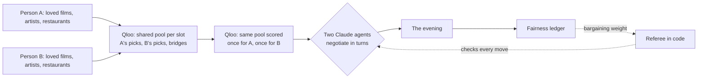

# Truce

**Two people, one evening, no one always giving in.**

Truce plans a shared evening (a film, a restaurant and music) for a couple or two friends. Each person tells Truce a few things they love. Each person then gets their own AI agent, grounded in [Qloo](https://www.qloo.com)'s taste graph, and the two agents negotiate until both sides accept a plan. A referee written in plain code keeps the negotiation honest. A **fairness ledger** remembers who gave ground last time and gives that person's agent more pull next time, so over many evenings neither person is always the one compromising.

**Live demo:** _link to come_ (one tap on "Try the demo" starts a real negotiation)

---

## The problem

"What do you want to do tonight?" "I don't mind, you pick." Recommenders can suggest a film for *one* person. Two people need three things recommenders don't do:

- **A middle ground** that is grounded in both people's real taste, not an average of genres.
- **Trade-offs across choices.** "You pick the film, I pick the food" is how people actually settle evenings.
- **Fairness over time.** The partner who always gives in stops enjoying the evening, even when each single choice looked reasonable.

## How it works



1. **Seeds.** Each person names a few films, artists and restaurants they love. Qloo's `/search` finds each one and the person confirms the match. Nothing about the person is sent: no names, no accounts, only Qloo entity IDs.
2. **The shared pool.** For each slot, Truce asks Qloo's Insights API three questions: what fits A's taste, what fits B's, and what fits **both seed sets together**. The last answer gives *bridges*, the options most likely to work for both people. Every seed counts as a signal in every slot, so a person's films and music also shape which restaurants come up (Qloo's cross-domain affinities).
3. **Two private scorecards.** The merged pool is scored **once per person** over exactly the same items (`filter.results.entities` with `feature.explainability`). Each agent gets its own person's scores from 0 to 100, plus which of their seeds drives each score ("In the Mood for Love, 56%"). An agent never sees the other person's scores.
4. **The negotiation.** Two agents on Claude Haiku 5.5 take turns. Each turn an agent either accepts the evening on the table or counters with a full evening and one or two sentences that cite Qloo's evidence. They trade across slots ("keep Katz's, and I'll meet you on the music") and steer toward bridges when they're stuck. After the final offer there is a **last call**: the other side can only take it or leave it.
5. **The referee.** Every move is checked in code, not by the model:
   - An agent may only offer real pool items.
   - An agent may never accept or offer an evening below its person's *minimum* for that turn. The minimum starts at the person's best evening and comes down turn by turn toward a floor near the fair evening.
   - A malformed, failed or late move is replaced by a rule-based agent, so a model mistake costs a sentence, never the evening.
   - With no deal, the referee rules the **weighted Nash bargaining solution**: the evening that maximises α·log(U_A) + (1−α)·log(U_B).
   - If another evening is better for *both* people than the one agreed, the referee upgrades to it.
6. **The ledger.** Each person's concession is recorded as their best possible evening minus what they got. The decayed balance of A's concessions minus B's sets the next truce's bargaining weight α, bounded between 0.35 and 0.65. The favoured person's agent also concedes more slowly. As they get their way, the balance drifts back to even.

## Why Qloo is essential here

Without Qloo there is no shared ground to negotiate over: an LLM alone would name famous titles and guess what two strangers might both like. With Qloo:

- **Bridges** come from a real joint signal: both people's seeds in one Insights query.
- **Each person's utility** is a measured affinity over the same pool, so the referee can compute a fair evening rather than asking a model to judge fairness.
- **Cross-domain affinity** lets a love of *In the Mood for Love* and Radiohead pull Perry St up the restaurant list.
- **Explainability** turns every agent claim into evidence the UI can show: which of your seeds drives this pick, and by how much.

### A request and its result (IDs shortened)

Scoring one shared shortlist for one person:

```http
GET /v2/insights
  ?filter.type=urn:entity:movie
  &signal.interests.entities=900B…FCF8,70CA…91C        # A's seeds: In the Mood for Love, Radiohead
  &filter.results.entities=<the 8 pool films>
  &feature.explainability=true
  &take=8
```

What Truce reads from each result:

| Field | Used for |
|---|---|
| `entity_id`, `name`, `properties.image.url` | the card |
| `query.affinity` | rescaled to 0–100 within the pool for this person |
| `query.explainability["signal.interests.entities"]` | the "because" lines: each seed's share of the score |
| `properties.emotional_tone_description`, `genres`, `cuisine_description`, `neighborhood`… | facts the agents may cite |

The same eight films scored for two different people on our demo pair:

| Film | Maya (art-house seeds) | Deniz (action seeds) |
|---|---|---|
| Chungking Express | high | low |
| Logan | low | high |
| Moonlight (a bridge) | high | high |

## What the result does not establish

- Qloo affinities describe **aggregate** taste correlations: "people who love X tend to love Y". They are not facts about the two people, and Truce presents them as evidence, not truth.
- Scores are rescaled **within one pool**, so a score says how an option ranks among tonight's options for that person, not how much they will enjoy it.
- **Restaurant quality depends on a loved restaurant as a seed.** Without one, only cross-domain signals shape the list, and they are weaker for places. Coverage is strongest in large cities.
- The **fairness ledger measures concessions on Truce's own scale.** It can't know about anything outside the app, such as the evening that was ruined by rain.

## Responsible data handling

- **Qloo only ever receives entity IDs and filters.** No names, accounts, device identifiers or locations of people.
- **The negotiation model receives** each person's nickname, their seeds and their scores, and nothing else.
- **Qloo responses are cached privately on the server** and never committed to this repository. Test fixtures are hand-written.
- **The public demo has limits.** Each client is rate-limited per action, request bodies are capped, and a daily cap on model-run truces switches to the rule-based agents rather than failing.

## Run it yourself

Requirements: Node.js 22.12 or newer, a Qloo API key, and optionally an Anthropic API key. Without the Anthropic key, the agents run on the rule-based fallback.

```sh
git clone https://github.com/yRemo05/truce && cd truce
cp .env.example .env          # set QLOO_API_KEY, QLOO_BASE_URL and, optionally, ANTHROPIC_API_KEY
npm ci && (cd web && npm ci)
npm run dev                   # API on http://localhost:8787
(cd web && npm run dev)       # web app on http://localhost:5173
```

Or build the single image: `docker build -t truce . && docker run -p 8787:8787 --env-file .env -v truce-data:/data truce`.

| Command | What it does |
|---|---|
| `npm test` | Four suites, no network: Qloo parsing and client, bargaining maths, ledger, and the referee over 150 random worlds plus four deliberately broken agents |
| `npm run smoke` | Live: builds the demo pair's pool from Qloo and prints both scorecards and the fair evening at three ledger tilts |
| `npm run live -- 0.65 b` | Live: a full negotiation between two Claude agents (α_A = 0.65, B opens), with the cost |

## Built with

- **[Qloo](https://www.qloo.com) Taste AI API:** `/search` and `/v2/insights`. Taste data from Qloo.
- **Claude Haiku 5.5** through the Anthropic API: structured outputs and prompt caching. About $0.003 per negotiation.
- **TypeScript and Node:** [Hono](https://hono.dev), [zod](https://zod.dev) and SQLite ([better-sqlite3](https://github.com/WiseLibs/better-sqlite3)).
- **Web app:** React and Vite.

## License

[MIT](LICENSE)
